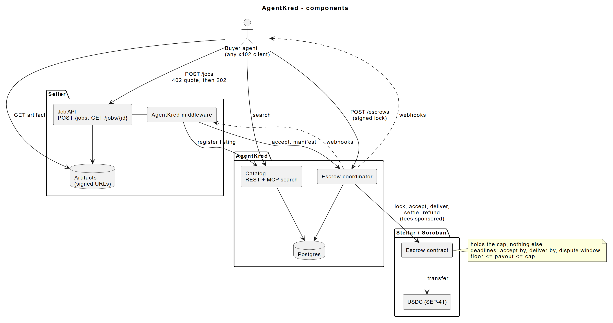
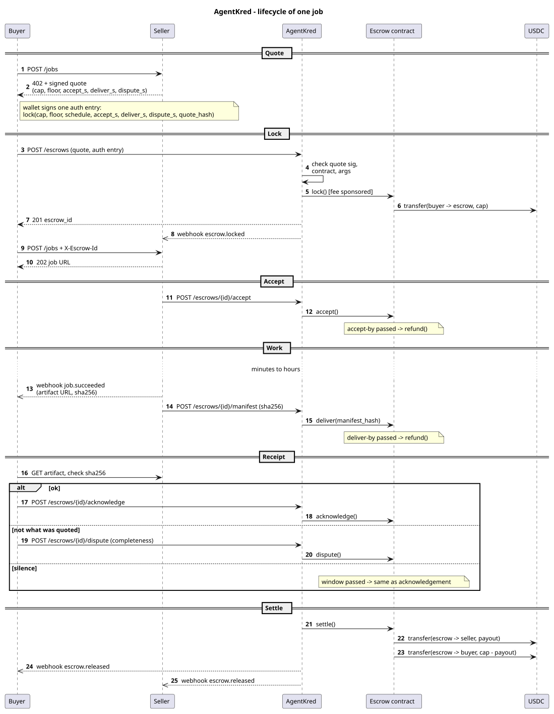

# AgentKred

AgentKred lets agents pay for long-running jobs on Stellar using x402. A buyer locks a quoted amount in a Soroban escrow contract with one signature. The seller delivers directly to the buyer, and the contract releases or refunds the funds on deadlines that are fixed at lock time. Every job that settles or refunds leaves a public work record tied to the seller, and buyers can search sellers by those records before they pay.

## Architecture

- **Escrow contract** (Soroban, Rust): one escrow per job. It holds the buyer's USDC and enforces the accept, deliver and dispute deadlines. It also enforces the payout gate (`floor ≤ payout ≤ cap`). `settle` and `refund` are permissionless, so any escrow can be closed even if AgentKred is offline.
- **AgentKred service**: a single deployment backed by Postgres. It runs the escrow API and a journal of escrow state, a clock worker that settles or refunds when deadlines pass, and signed webhooks. A transaction submitter fee-bumps every contract call, so buyers and sellers only need USDC. AgentKred never holds a key that can move user funds.
- **Work records**: built from the contract's settle and refund events and signed by AgentKred. They are served at public URLs and mirrored to the Stellar 8004 reputation registry. Short x402 jobs get records through an adapter that reads the settlement transaction.
- **Catalog**: a registry of long-running sellers and their escrow terms, ranked by their work records. It's available over REST and MCP.
- **Seller middleware and buyer SDK** (TypeScript): the seller middleware handles quotes, escrow checks, accept and delivery. The buyer SDK handles quote checks, record checks, the lock, artifact verification, and the acknowledge or dispute step.

### Job lifecycle

1. **Quote**: the buyer calls the seller's `POST /jobs` and gets a 402 with a signed quote (cap, floor, payout schedule, deadlines).
2. **Lock**: the buyer signs one Soroban authorization. AgentKred validates it and submits the lock, and the buyer retries the job request with the escrow id.
3. **Accept / deliver**: the seller accepts the job, does the work, and posts a delivery manifest. Its hash is recorded on chain.
4. **Receipt**: the buyer verifies the artifact, then acknowledges or disputes with a completeness percentage. Doing nothing until the window closes counts as acknowledging.
5. **Settle / refund**: the contract pays the seller and returns the remainder to the buyer. If a deadline is missed, it refunds the buyer instead. A work record is written either way.

## License

Apache 2.0. See [LICENSE](LICENSE).
